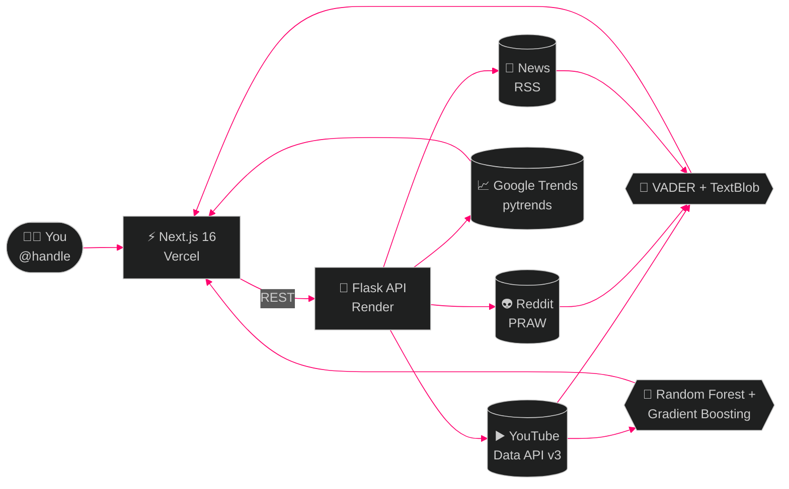

<div align="center">

<a href="https://creator-iq-gules.vercel.app/">
  
</a>

<a href="https://creator-iq-gules.vercel.app/">
  
</a>

<br/>

<a href="https://creator-iq-gules.vercel.app/"></a>
<a href="https://creatoriq-backend-986h.onrender.com/api/health"></a>
<a href="https://github.com/harshgupta257/CreatorIq/stargazers"></a>
<a href="#license"></a>

</div>

<br/>

<!-- ═══════════════════════ PROFILE ═══════════════════════ -->

<div align="center">

<table>
  <tr>
    <td align="center" width="140"><h3>7</h3><sub>MODULES</sub></td>
    <td align="center" width="140"><h3>4</h3><sub>DATA SOURCES</sub></td>
    <td align="center" width="140"><h3>12 wk</h3><sub>FORECAST</sub></td>
    <td align="center" width="140"><h3>3</h3><sub>RIVALS TRACKED</sub></td>
    <td align="center" width="140"><h3>$0</h3><sub>FOREVER</sub></td>
  </tr>
</table>

**CreatorIQ** ✔︎ &nbsp;·&nbsp; `@creatoriq`

YouTube Studio gives you views. **CreatorIQ gives you intelligence.**<br/>
ML growth predictions · multi-source sentiment · competitor tracking · Google Trends<br/>
🔗 [creator-iq-gules.vercel.app](https://creator-iq-gules.vercel.app/) &nbsp;·&nbsp; 📍 Vercel + Render &nbsp;·&nbsp; 🛠️ built by [@harshgupta257](https://github.com/harshgupta257)

[**⭐ Follow (star)**](https://github.com/harshgupta257/CreatorIq/stargazers) &nbsp;·&nbsp; [**🍴 Remix (fork)**](https://github.com/harshgupta257/CreatorIq/fork) &nbsp;·&nbsp; [**💬 Message (issues)**](https://github.com/harshgupta257/CreatorIq/issues)

</div>

<!-- ═══════════════════════ STORY HIGHLIGHTS ═══════════════════════ -->

<div align="center">

<table>
  <tr>
    <td align="center"><a href="#pinned"><b>📌</b><br/><sub>Pinned</sub></a></td>
    <td align="center"><a href="#feed"><b>📰</b><br/><sub>Feed</sub></a></td>
    <td align="center"><a href="#thread"><b>🧵</b><br/><sub>How it works</sub></a></td>
    <td align="center"><a href="#golive"><b>🚀</b><br/><sub>Go live</sub></a></td>
    <td align="center"><a href="#api"><b>🔌</b><br/><sub>API</sub></a></td>
    <td align="center"><a href="#aesthetic"><b>🎨</b><br/><sub>Aesthetic</sub></a></td>
    <td align="center"><a href="#scheduled"><b>🗓️</b><br/><sub>Up next</sub></a></td>
    <td align="center"><a href="#collab"><b>🤝</b><br/><sub>Collab</sub></a></td>
  </tr>
</table>

<sub>👆 tap a highlight to jump</sub>

</div>


<!-- ═══════════════════════ PINNED ═══════════════════════ -->

<a name="pinned"></a>

## 📌 Pinned post

> **@creatoriq** · *pinned*
>
> Your platform shows you *what* happened. We show you **why**, and **what's next**. 👇

| 😴 What YouTube Studio gives you | ⚡ What CreatorIQ gives you |
|---|---|
| Total views & watch time | ML-predicted growth trajectory (12 weeks) |
| Basic subscriber count | Competitor health scores & gap analysis |
| Simple engagement rate | Multi-source sentiment (YouTube + Reddit + News) |
| Upload history | Optimal upload day/hour heatmap |
| Nothing about competition | Content gap analysis vs 3 competitors |
| No external signal | Google Trends integration for topic demand |

<sub>❤️ like it? &nbsp;[⭐ star](https://github.com/harshgupta257/CreatorIq/stargazers) &nbsp;·&nbsp; 🔁 [share the live app](https://creator-iq-gules.vercel.app/) &nbsp;·&nbsp; 💬 [reply in issues](https://github.com/harshgupta257/CreatorIq/issues)</sub>


<!-- ═══════════════════════ FEED ═══════════════════════ -->

<a name="feed"></a>

## 📰 The feed

<sub>Every module is a post. **Tap one to expand.**</sub>

<details>
<summary><b>@creatoriq</b> posted &nbsp;📊 <b>Overview Dashboard</b> &nbsp;<code>#analytics</code> <code>#overview</code></summary>
<br/>

- **Inline metric strip**: Total Views, Subscribers, Videos, Avg Engagement, Avg Views/Video
- **Performance trend chart**: full-width area chart of your last 30 videos' views
- **Audience sentiment snapshot**: Positive / Neutral / Negative from the combined multi-source analysis
- **Top videos**: horizontal bar chart of your top 6 videos by views
- **Data source status**: live indicators for YouTube, Reddit, Trends, News and Instagram
- **Intelligence insights**: auto-generated from the ML model (viral score, best day, top topic)

<sub>❤️ the home screen &nbsp;·&nbsp; 📍 <code>/dashboard</code></sub>
</details>

<details>
<summary><b>@creatoriq</b> posted &nbsp;▶️ <b>YouTube Analytics</b> &nbsp;<code>#youtube</code> <code>#videos</code></summary>
<br/>

- **Channel overview strip**: avatar, title, subscribers, views, video count, join year
- **Sortable video table**: thumbnail, title, date, views, likes, comments, engagement rate, performance bar
- **Time range filter**: Last 30 / Last 90 / All Time
- **Upload frequency heatmap**: 7-day × time-slot grid from real publish timestamps
- **Best time to post**: calculated from your historical performance, not guesswork
- **Export CSV**: download your video data

<sub>📍 <code>/dashboard/youtube</code></sub>
</details>

<details>
<summary><b>@creatoriq</b> posted &nbsp;🧠 <b>ML Growth Predictions</b> &nbsp;<code>#machinelearning</code> <code>#forecast</code> &nbsp;⭐ <i>hero screen</i></summary>
<br/>

- **Model status bar**: shows whether the Random Forest is trained or running in heuristic mode, with R² accuracy
- **Forecast summary**: projected weekly views, viral potential score, best upload day, optimal duration
- **Growth trajectory**: historical (solid) + 12-week forecast (dashed) in one chart
- **Title intelligence**: boost % from numbers, question marks and colons in titles; power words; best example
- **Topic performance**: which content topics get the most average views
- **Upload time optimizer**: 7×6 day × time-slot heatmap with the best cell highlighted
- **Video predictions table**: actual vs predicted views, delta, confidence bar
- **Content recommendations**: proven and trending topics, with reasoning

<sub>🤖 Random Forest + Gradient Boosting (scikit-learn) &nbsp;·&nbsp; 📍 <code>/dashboard/predictions</code></sub>
</details>

<details>
<summary><b>@creatoriq</b> posted &nbsp;💬 <b>Audience Sentiment</b> &nbsp;<code>#sentiment</code> <code>#nlp</code></summary>
<br/>

- **3-source comparison**: YouTube comments, Reddit discussions and news media, side by side
- **Word frequency cloud**: top words, sized by frequency
- **Sentiment over time**: line chart around a neutral axis
- **Top positive comments**: real excerpts with author and likes
- **Top critical comments**: real excerpts with author and likes

<sub>🧪 VADER + TextBlob &nbsp;·&nbsp; 📍 <code>/dashboard/sentiment</code></sub>
</details>

<details>
<summary><b>@creatoriq</b> posted &nbsp;📈 <b>Google Trends</b> &nbsp;<code>#trending</code> <code>#topics</code></summary>
<br/>

- **Status bar**: tracked keywords, rate-limit state and a direct link to Google Trends
- **Interest over time**: multi-line chart, one line per keyword
- **Related queries**: Top and Rising queries with relative value bars
- **Geographic interest**: ranked country list with relative bars

<sub>📍 <code>/dashboard/trends</code></sub>
</details>

<details>
<summary><b>@creatoriq</b> posted &nbsp;⚔️ <b>Competitor Intelligence</b> &nbsp;<code>#competition</code> <code>#strategy</code></summary>
<br/>

- **Add up to 3 competitors**: by @handle or URL, loaded live from the YouTube API
- **Health score comparison**: grade letters (A+/A/B/C/D/F) for each channel
- **Metrics face-off**: subscribers, views, avg views/video, views/subscriber, uploads/month, channel age, with the winner highlighted
- **Bar chart comparison**: subscribers and avg views/video side by side
- **Content gap analysis**: tags competitors cover that you don't, with "covered by ×2/×3" badges
- **Strategic insights**: auto-generated rows comparing you vs the competition

<sub>📍 <code>/dashboard/competitor</code></sub>
</details>

<details>
<summary><b>@creatoriq</b> shared a story &nbsp;📸 <b>Instagram</b> &nbsp;<code>#comingsoon</code></summary>
<br/>

- A deliberate preview wireframe, not a blank page
- Teases follower growth, post analytics, cross-platform correlation and story analytics
- Notify button for early access

<sub>⏳ Instagram Graph API integration is on the roadmap &nbsp;·&nbsp; 📍 <code>/dashboard/instagram</code></sub>
</details>


<!-- ═══════════════════════ THREAD ═══════════════════════ -->

<a name="thread"></a>

## 🧵 How it works (a thread)

**1/3** You drop a handle. The Next.js app calls the Flask API, which fans out to four data sources at once.



**2/3** Comments from YouTube, Reddit and the news are scored for sentiment, while your upload history trains the growth model.

**3/3** Everything comes back to one dashboard: forecasts, sentiment, trends and competitor intel. No account needed. 🫡

<details>
<summary>🗂️ <b>Peek at the folder structure</b></summary>
<br/>

```
CreatorIQ
├── .github/assets/                # README banner, divider, footer (animated SVG)
├── CreatorLab/                    # Backend + legacy frontend
│   ├── backend/
│   │   ├── app.py                 # Flask API server (all endpoints)
│   │   ├── youtube_api.py         # YouTube Data API v3 wrapper
│   │   ├── reddit_api.py          # PRAW Reddit wrapper
│   │   ├── sentiment_analysis.py  # VADER + TextBlob multi-source
│   │   ├── google_trends.py       # pytrends wrapper
│   │   ├── news_scraper.py        # News RSS sentiment
│   │   ├── ml_models.py           # Random Forest + Gradient Boosting predictor
│   │   ├── instagram_api.py       # Instagram Graph API (WIP)
│   │   └── requirements.txt
│   ├── dashboard.html             # Legacy vanilla dashboard
│   └── index.html                 # Legacy landing page
│
└── creatorlab-frontend/           # Next.js 16 app
    ├── app/
    │   ├── page.tsx               # Retro-futurism landing page
    │   ├── globals.css            # Neon design system (CRT, glow, glitch)
    │   ├── privacy/ · terms/      # Legal pages
    │   ├── sitemap.ts · robots.ts # SEO
    │   └── dashboard/
    │       ├── layout.tsx         # Shell (Sidebar + Header)
    │       ├── page.tsx           # Overview
    │       ├── youtube/           # YouTube analytics
    │       ├── sentiment/         # Multi-source sentiment
    │       ├── predictions/       # ML predictions
    │       ├── trends/            # Google Trends
    │       ├── competitor/        # Competitor intelligence
    │       ├── instagram/         # Coming soon
    │       └── settings/          # Settings
    ├── components/
    │   ├── shell/                 # Sidebar, Header
    │   ├── ui/                    # Button, Badge, DataTable, MetricStrip, TabBar, Input, Panel, Skeleton, SectionHeader
    │   ├── dashboard/             # OverviewCharts
    │   ├── predictions/           # ForecastChart, TopicBar, HeatmapGrid, VideoTable
    │   └── legal/                 # LegalPage
    └── lib/
        ├── api.ts                 # Typed Flask API client
        ├── store.ts               # Zustand global state (persisted)
        ├── types.ts               # TypeScript interfaces
        └── utils.ts               # formatNumber, formatDate, calcEngagementRate, …
```

</details>


<!-- ═══════════════════════ GO LIVE ═══════════════════════ -->

<a name="golive"></a>

## 🚀 Go live in 4 steps

> [!TIP]
> **Just want to try it?** Skip all this and open the **[live app](https://creator-iq-gules.vercel.app/)**. The backend runs on Render's free tier, so the first request after a quiet spell can take ~30 seconds to wake up.

<details open>
<summary><b>🧰 Before you start</b></summary>
<br/>

| Requirement | Version |
|---|---|
| Python | 3.11 |
| Bun | 1.3+ (or Node.js 18+) |
| Git | Any |

| API key | Where to get it | Required? |
|---|---|---|
| YouTube Data API v3 | [console.cloud.google.com](https://console.cloud.google.com) | ✅ Yes |
| Reddit API (PRAW) | [reddit.com/prefs/apps](https://www.reddit.com/prefs/apps) | Optional |
| News API | [newsapi.org](https://newsapi.org) | Optional |

</details>

**Step 1 · Clone**

```bash
git clone https://github.com/harshgupta257/CreatorIq.git
cd CreatorIq
```

**Step 2 · Start the backend**

```bash
cd CreatorLab/backend
pip install -r requirements.txt
```

Create a `.env` file:

```env
YOUTUBE_API_KEY=AIza...
REDDIT_CLIENT_ID=your_client_id
REDDIT_CLIENT_SECRET=your_client_secret
REDDIT_USER_AGENT=CreatorIQ/1.0 by u/youruser
NEWS_API_KEY=your_news_api_key
```

```bash
python app.py
# ✓ Running on http://localhost:5000
```

**Step 3 · Start the frontend**

```bash
cd ../../creatorlab-frontend
bun install       # or: npm install
bun run dev       # or: npm run dev
# ✓ Running on http://localhost:3000
```

> [!NOTE]
> Make sure Flask is running on port `5000` **before** you open the frontend.

**Step 4 · Go viral (well, analyze)**

Open **http://localhost:3000**, enter a channel handle (e.g. `@mkbhd`) and hit **Analyze**. 🎬


<!-- ═══════════════════════ API ═══════════════════════ -->

<a name="api"></a>

## 🔌 API: slide into the endpoints

<details>
<summary><b>All endpoints return JSON. Tap to expand.</b></summary>
<br/>

| Method | Endpoint | What it does |
|---|---|---|
| `GET` | `/api/health` | Health check + API key status |
| `GET` | `/api/youtube/channel?url=` | Channel stats by URL or @handle |
| `GET` | `/api/youtube/videos?channel_id=` | Video list with stats |
| `GET` | `/api/youtube/comments?video_id=` | Top comments for a video |
| `GET` | `/api/sentiment/analyze?channel_id=&channel_name=` | Multi-source sentiment analysis |
| `GET` | `/api/predictions?channel_id=` | ML predictions (growth forecast, viral score, …) |
| `GET` | `/api/trends?query=&channel_id=` | Google Trends data |
| `GET` | `/api/reddit/sentiment?query=` | Reddit-only sentiment |
| `GET` | `/api/news?query=` | News sentiment |
| `POST` | `/api/instagram/connect` | Instagram connect (WIP) |
| `GET` | `/api/instagram/insights` | Instagram insights (WIP) |

Try it live: **[`/api/health`](https://creatoriq-backend-986h.onrender.com/api/health)**

</details>


<!-- ═══════════════════════ AESTHETIC ═══════════════════════ -->

<a name="aesthetic"></a>

## 🎨 The aesthetic: retro-futurism

<sub>80s synthwave meets creator analytics: neon on deep black, CRT scanlines, glitch type.</sub>

<div align="center">


</div>

| Effect | How |
|---|---|
| 📺 CRT scanlines | Fixed `::before` overlay, `--scanline-opacity: 0.3` (softer on data screens) |
| ✨ Neon glow | Layered `text-shadow` + `box-shadow` in each neon color |
| ⚡ Glitch | Pink/cyan `::before`/`::after` slices with skew + offset keyframes |
| 🌈 Color cycle | `filter: hue-rotate()` animation |
| 🌅 Synthwave hero | Striped CSS sun, perspective grid floor, rotating wireframe cube |
| 🔤 Type | Geist Mono for body, Geist Pixel for headlines |

<sub>All tokens live in <code>creatorlab-frontend/app/globals.css</code>.</sub>


## 🛠️ The stack

<div align="center">


</div>

<details>
<summary><b>🖥️ Frontend packages</b></summary>
<br/>

| Package | Purpose |
|---|---|
| `next` 16.3 | App Router, SSR, routing |
| `react` 19 | UI library |
| `typescript` 5 | Type safety |
| `tailwindcss` v4 | Utility CSS with `@theme` tokens |
| `recharts` | Data visualization |
| `zustand` | Global state (persisted) |
| `framer-motion` | Scroll reveals and animations |
| `lucide-react` | Icons |
| `geist` | Geist Mono + Geist Pixel fonts |
| `clsx` | Conditional class merging |

</details>

<details>
<summary><b>🐍 Backend packages</b></summary>
<br/>

| Package | Purpose |
|---|---|
| `flask` + `flask-cors` | API server |
| `google-api-python-client` | YouTube Data API v3 |
| `praw` | Reddit API |
| `pytrends` | Google Trends (unofficial) |
| `vaderSentiment` | Sentiment analysis (primary) |
| `textblob` | Sentiment analysis (secondary) |
| `scikit-learn` | Random Forest + Gradient Boosting models |
| `numpy` / `pandas` | Data processing |
| `requests` | HTTP requests |
| `python-dotenv` | Environment variables |

</details>


<!-- ═══════════════════════ SCHEDULED ═══════════════════════ -->

<a name="scheduled"></a>

## 🗓️ Scheduled posts (roadmap)

| Status | Post |
|:---:|---|
| ✅ | YouTube analytics deep-dive |
| ✅ | Multi-source sentiment (YouTube + Reddit + News) |
| ✅ | ML growth predictions (Random Forest + Gradient Boosting) |
| ✅ | Google Trends integration |
| ✅ | Competitor intelligence console |
| ✅ | Retro-futurism redesign (landing + dashboard) |
| 🕒 | Instagram Graph API integration |
| 🕒 | TikTok analytics |
| 🕒 | Email digest / weekly reports |
| 🕒 | OAuth login (connect your YouTube account) |
| 🕒 | Historical data persistence (SQLite/Postgres) |

<sub>Want something on this list? [Request it](https://github.com/harshgupta257/CreatorIq/issues).</sub>


<!-- ═══════════════════════ COLLAB ═══════════════════════ -->

<a name="collab"></a>

## 🤝 Collabs open

DMs (issues) and collabs (PRs) are always welcome.

```bash
# Fork the repo, then:
git checkout -b feature/your-feature
git commit -m "feat: describe your change"
git push origin feature/your-feature
# …and open a Pull Request
```

[](https://github.com/harshgupta257/CreatorIq/issues)
[](https://github.com/harshgupta257/CreatorIq/issues)

<a name="license"></a>

## 📄 License

Released under the **MIT License**.

<br/>

<div align="center">

<a href="https://github.com/harshgupta257/CreatorIq/stargazers">
  
</a>

Built with obsession by [**@harshgupta257**](https://github.com/harshgupta257)

<sub><i>"I don't want a beautiful dashboard. I want a beautiful analytical instrument."</i></sub>

</div>
